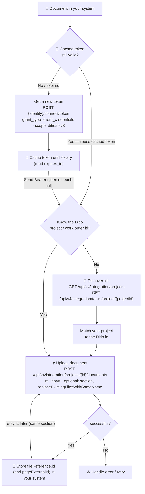

# 04 — Documents

Push documents (PDF, Word, images, …) to Ditio **projects** and **work orders**, and look up the ids you need to do so. Documents you push are surfaced in the Ditio **Info Center**, so field workers assigned to the project see them in the **mobile app** — grouped into a folder per project, and (optionally) into named **sections** within it.

`api/v4/integration/projects/{id}/documents` · scope `ditioapiv3`. Set `$BASE_URL` / `$TOKEN` first — see [`../authentication`](../authentication). Runnable C# example: [`DocumentsExample.cs`](DocumentsExample.cs).

## Concepts (read this first)

| Term | What it is |
|------|------------|
| **Project** | A top-level job in Ditio. Has a Ditio **id** (a string like `65f1a2b3c4d5e6f7a8b9c0d1`) and a human **project number** (e.g. `P-2025-001`). |
| **Work order** (called a *task* in the API) | A unit of work inside a project. Also has a Ditio **id**. |
| **Document** | Any file (PDF, Word, image, …) you push to a project or work order. It becomes a document on an Info Center page, visible to that project's members on mobile. |
| **Section** | Optional name that groups a project's documents into a page (e.g. `Drawings`, `Contracts`). Re-using the same `(project, section)` adds to the same page. Omit it and documents land on a default **"Documents"** page. A section can be a **path** — `Dokumenter/Tillegg og endringer/Endringsmeldinger` — to build folders inside the project's folder ([Step 7](#step-7--folders-inside-the-project-section-paths)). |
| **`fileReference.id`** | The id Ditio gives back when you push a document. Save it — you need it to download or delete that document later — or delete by section and file name instead, or use your own ids ([Step 8](#step-8--mirror-your-folder-tree-with-your-own-ids)). |
| **`pageExternalId`** | Returned on upload; the stable handle of the Info Center page the documents landed on. |
| **Your own ids** (`sectionId`, `fileId`) | Optional: address folders, pages and documents by the ids your own system already has (e.g. SharePoint item ids), so renames and moves follow ([Step 8](#step-8--mirror-your-folder-tree-with-your-own-ids)). |

You push a document using the **Ditio id** of a project or work order — **steps 2 and 3 below show how to find them** — or, for a project, by its **project number**. Upload, list, describe, delete by name and the your-own-id endpoints all also exist under `/api/v4/integration/projects/by-project-number/{projectNumber}/documents…`, so you never need to look up or store Ditio's project id. Download and delete by Ditio's `fileReferenceId` take the project id.

> **Auth:** every request needs a Bearer token with the `ditioapiv3` scope (step 1). Your API client must have **Administrator** access, and can only see/act on projects in your own company.

## Environments

| | Production | Test |
|---|---|---|
| **API base** | `https://integration.ditio.no` | `https://core-api.ditio.dev/core` |
| **Identity (token endpoint)** | `https://identity.ditio.app/connect/token` | `https://identity.ditio.dev/connect/token` |
| **Scope** | `ditioapiv3` | `ditioapiv3` |
| **Swagger** | `https://integration.ditio.no/swagger` | `https://core-api.ditio.dev/core/swagger` |

The curl examples below work for **either environment** — set `IDENTITY` and `BASE_URL` once (see step 1) to the Production or Test values from the table above. In Postman, import the matching environment file (*Production* or *Test*) and select it. Credentials are issued separately per environment, and test data is periodically re-synced from production (anything created directly in test may be overwritten).

---

## Integration flow at a glance



> **Reuse the token.** Cache it and send it on every call; request a new one shortly before it expires — see [Step 1](#step-1--get-a-token). A `401` can also mean the API client is unavailable; see [authentication troubleshooting](../authentication/README.md#troubleshooting-a-401). Don't fetch a token per request; that needlessly loads the identity server.
>
> The dashed path is the re-sync case: re-upload to the **same `(project, section)`** to add to the same Info Center page. Pass `replaceExistingFilesWithSameName=true` to replace same-named files instead of keeping both.
>
> **Work orders work the same way** — swap `projects` for `tasks` and use the work order id: `POST /api/v4/integration/tasks/{id}/documents` (see [Step 4 → To a work order](#to-a-work-order)).

---

## Where your documents land (data flow)

You push documents to a **project** (or work order). Behind the scenes, Ditio routes each document into the project's **Info Center** — creating a folder per project and a page per `section` — so the project's field workers see them in the **mobile app**. You never call the Info Center directly; the document endpoints do it for you, idempotently.

```mermaid
flowchart LR
    subgraph Src["🏢 Document system"]
        D["📄 Project documents<br/>drawings, contracts, …"]
    end

    subgraph API["⚙️ Ditio Core — Integration API"]
        EP["POST projects/{id}/documents<br/>multipart · ?section · Bearer token"]
        SVC["Routing: document → Info Center<br/>(idempotent upsert)"]
    end

    subgraph Store["🗄️ Ditio Info Center"]
        FOLDER["📁 Folder — one per project<br/>'P-2025-001 - Highway E6'"]
        PAGE["📑 Page — one per section<br/>'Drawings', 'Contracts', …"]
        FILE["📎 Documents on the page"]
    end

    subgraph Mobile["📱 Ditio mobile app"]
        FW["👷 Field worker assigned to the project<br/>Info Center → folder → page → open document"]
    end

    D -->|"1 · upload"| EP
    EP -->|"2 · verify your company owns the project"| SVC
    SVC -->|"3 · ensure folder (by project)"| FOLDER
    FOLDER --> PAGE
    SVC -->|"4 · ensure page (by project + section)"| PAGE
    PAGE --> FILE
    SVC -->|"5 · attach files (dedupe / replace-by-name)"| FILE
    FILE -->|"6 · visible to project members"| FW
    EP -.->|"returns fileReference.id + pageExternalId"| D
```



**What gets created** — the durable handle is `(project, section)`; re-syncing to the same handle updates the same page rather than duplicating it:

```
📁  P-2025-001 - Highway E6            (folder, one per project, visible to the project's employees)
    ├── 📑 Drawings                    (section page)
    │     ├── 📎 Drawing-A1.pdf
    │     └── 📎 Site-plan.docx
    ├── 📑 Contracts                   (section page)
    │     └── 📎 Main-contract.pdf
    └── 📑 Documents                   (default page — used when no section is given)
          └── 📎 Misc.pdf
```

> **Visibility:** each project folder/page is scoped to that project, so it's shown to **active employees assigned to the project** in your company. Documents pushed to a **work order** nest under the same per-project folder.

---

## Step 1 — Get a token

1. In [Ditio Web](https://app.ditio.no) → **Company Setup** → **Integration**, create an API client and copy its `client_id` and `client_secret` (the secret is shown once). Full details: [`../authentication`](../authentication).
2. Choose your environment — set these once (values from the [Environments](#environments) table):

```bash
# Production
IDENTITY=https://identity.ditio.app
BASE_URL=https://integration.ditio.no

# Test — comment out the two production lines above and use these instead
# IDENTITY=https://identity.ditio.dev
# BASE_URL=https://core-api.ditio.dev/core
```

3. Request a token:

```bash
TOKEN=$(curl -s -X POST $IDENTITY/connect/token \
  -H "Content-Type: application/x-www-form-urlencoded" \
  -d "grant_type=client_credentials" \
  -d "client_id=YOUR_CLIENT_ID" \
  -d "client_secret=YOUR_CLIENT_SECRET" \
  -d "scope=ditioapiv3" | jq -r '.access_token')
```

4. Send `Authorization: Bearer $TOKEN` on every request below.

> **Tokens are short-lived** — about **30 minutes** by default (configurable per client, up to 24 hours). **Cache the token and reuse it** across requests; fetch a new one shortly before it expires (read `expires_in` from the token response). For a `401`, check the token and API client as described in [authentication troubleshooting](../authentication/README.md#troubleshooting-a-401). Never request a fresh token per call.

### Reusing the token (example)

```csharp
// Cache the token; only fetch a new one shortly before it expires.
private static string _token;
private static DateTime _tokenExpiresUtc = DateTime.MinValue;

async Task<string> GetTokenAsync(HttpClient http)
{
    // Refresh ~1 minute early so a token never expires mid-request.
    if (_token is not null && DateTime.UtcNow < _tokenExpiresUtc.AddMinutes(-1))
        return _token;

    // identityUrl = https://identity.ditio.app (production) or https://identity.ditio.dev (test)
    var response = await http.PostAsync(
        $"{identityUrl}/connect/token",
        new FormUrlEncodedContent(new Dictionary<string, string>
        {
            ["grant_type"]    = "client_credentials",
            ["client_id"]     = clientId,
            ["client_secret"] = clientSecret,
            ["scope"]         = "ditioapiv3",
        }));
    response.EnsureSuccessStatusCode();

    var token = await response.Content.ReadFromJsonAsync<TokenResponse>();
    _token = token!.access_token;
    _tokenExpiresUtc = DateTime.UtcNow.AddSeconds(token.expires_in);
    return _token;
}

private record TokenResponse(string access_token, int expires_in, string token_type);
```

---

## Step 2 — Find your projects (get the project id)

List every project in your company:

```bash
curl -X GET $BASE_URL/api/v4/integration/projects \
  -H "Authorization: Bearer $TOKEN"
```

**Response** (array — one entry per project):

```json
[
  {
    "id": "65f1a2b3c4d5e6f7a8b9c0d1",
    "companyId": "YOUR_COMPANY_ID",
    "projectNumber": "P-2025-001",
    "name": "Highway E6 - North section",
    "active": true
  }
]
```

The **`id`** is what you'll use to attach documents. If you already know the project number, you can fetch a single project directly:

```bash
curl -X GET $BASE_URL/api/v4/integration/projects/by-project-number/P-2025-001 \
  -H "Authorization: Bearer $TOKEN"
```

More project endpoints: [`../projects`](../projects).

---

## Step 3 — Find work orders in a project (get the work order id)

Using the project `id` from step 2, list its work orders:

```bash
curl -X GET $BASE_URL/api/v4/integration/tasks/project/65f1a2b3c4d5e6f7a8b9c0d1 \
  -H "Authorization: Bearer $TOKEN"
```

**Response** (array — one entry per work order):

```json
[
  {
    "id": "66a1b2c3d4e5f6a7b8c9d0e2",
    "projectId": "65f1a2b3c4d5e6f7a8b9c0d1",
    "externalId": "WO-100",
    "name": "Foundation work",
    "active": true
  }
]
```

You can also list work orders by project number:

```bash
curl -X GET $BASE_URL/api/v4/integration/tasks/by-project-number/P-2025-001 \
  -H "Authorization: Bearer $TOKEN"
```

More work-order endpoints: [`../work-orders`](../work-orders).

> **Tip — discovering everything in bulk.** Steps 2–3 fetch projects/work orders on demand, which is ideal for a first integration. If you later need to mirror the *entire* catalogue (e.g. a nightly sync of all projects and work orders), use the paginated **Data Extraction API** instead: `GET /v1/project` (all project metadata) and `GET /v1/project/work-breakdown-structure` (all work orders / WBS). Those use a different scope (`reportingapiv1`) and return results in pages with a continuation token — see [`../data-extraction`](../data-extraction).

---

## Step 4 — Upload documents

### To a project

```
POST /api/v4/integration/projects/{id}/documents
POST /api/v4/integration/projects/by-project-number/{projectNumber}/documents
```

Send one or more files as `multipart/form-data`. Query parameters (all optional):

| Param | Effect |
|-------|--------|
| `section` | Groups the documents onto a named page under the project's document folder (e.g. `Drawings`). Re-use the same value to add more documents to that page. Omit it → a default **"Documents"** page. Separate levels with `/` to put the page inside folders — see [Step 7](#step-7--folders-inside-the-project-section-paths). |
| `replaceExistingFilesWithSameName` | When `true`, documents already on the page with the same filename are replaced (use on re-sync to avoid duplicates). |
| `sectionId` | Instead of `section`: your own id of a page created in [Step 8](#step-8--mirror-your-folder-tree-with-your-own-ids). Sending both `section` and `sectionId` is rejected with `400`. |
| `fileId` | Your own id for the document. Upload exactly one file with it (`400` otherwise). Uploading the same `fileId` again replaces the document, wherever on the project it was. |

**Upload restrictions:** keep the complete multipart request, including its boundaries and fields, below
30,000,000 bytes. Larger requests return `413` before file validation. Send larger batches as separate requests.
SVG files have a separate 5 MiB limit and must be well-formed without active script content.

HTML/web documents, scripts and executable extensions are refused with `400`, including `.html`, `.htm`,
`.mht`, `.mhtml`, `.js`, `.exe`, `.ps1` and `.svgz`. Trailing dots and spaces are removed before checking
the extension. A recognized non-image payload with an image filename is also refused; renaming HTML to
`.jpg` does not make it an accepted image. Validation errors use the API's translated business-error
response. Correct the input before retrying a `400` or `413`.

```bash
curl -X POST "$BASE_URL/api/v4/integration/projects/65f1a2b3c4d5e6f7a8b9c0d1/documents?section=Drawings&replaceExistingFilesWithSameName=true" \
  -H "Authorization: Bearer $TOKEN" \
  -F "file=@/path/to/Drawing-A1.pdf" \
  -F "file=@/path/to/Site-plan.docx"
```

**Response:**

```json
{
  "successful": true,
  "message": "Documents uploaded and attached ok",
  "section": "Drawings",
  "pageExternalId": "int-projdocs:65f1a2b3c4d5e6f7a8b9c0d1:drawings",
  "files": [
    {
      "name": "Drawing-A1.pdf",
      "size": 482113,
      "url": "/api/file/66b1a2c3d4e5f6a7b8c9d0e2",
      "fileReference": {
        "id": "66b1a2c3d4e5f6a7b8c9d0e2",
        "collectionRef": "InfoMessage",
        "fileNameOrig": "Drawing-A1.pdf",
        "fileType": "pdf",
        "fileSize": 482113,
        "createdDateTime": "2026-06-05T08:10:25Z"
      }
    }
  ],
  "infoPageFiles": [
    { "fileReferenceId": "66b1a2c3d4e5f6a7b8c9d0e2", "name": "Drawing-A1.pdf" }
  ]
}
```

> `files` are the documents created by *this* request; `infoPageFiles` is everything on the page after the upload. Store `files[].fileReference.id` — it's the handle for downloading or deleting a document. The documents are now visible to the project's members in the mobile app's Info Center.

### To a work order

Identical, using the work order id from step 3, and it takes the same `section` and `replaceExistingFilesWithSameName` query parameters. The work order's documents nest under its **parent project's** folder; when you omit `section` it defaults to the work order's number/short description. On a work order, `section` is always one level: a `/` in it is part of the page name. Section paths, `sectionId` and `fileId` are available on project uploads only.

```bash
curl -X POST "$BASE_URL/api/v4/integration/tasks/66a1b2c3d4e5f6a7b8c9d0e2/documents" \
  -H "Authorization: Bearer $TOKEN" \
  -F "file=@/path/to/Method-statement.pdf"
```

---

## Step 5 — List, download, replace, delete

**List the document pages on a project or work order (sections + their files):**

```
GET /api/v4/integration/projects/{id}/documents
GET /api/v4/integration/projects/by-project-number/{projectNumber}/documents
GET /api/v4/integration/tasks/{id}/documents
```

Returns the section pages at every depth — each with `section` (its full path, e.g. `Dokumenter/Tillegg og endringer/Endringsmeldinger`), `sectionId` (your id, when the page was created with one; otherwise `null`), `pageExternalId`, and a `files` array of `{ fileReferenceId, name, fileId }` (`fileId` is your id, when the document was uploaded with one). For a work order, it returns the work order's own section page.

The path is built from the titles of the levels, so a title that itself contains `/` (renamed in Ditio Web, or a work
order's name) reads as an extra level — use `sectionId` or `pageExternalId` when you need an exact handle.

```json
[
  {
    "section": "Dokumenter/Tegninger",
    "sectionId": null,
    "pageExternalId": "int-projdocs:65f1a2b3c4d5e6f7a8b9c0d1:dokumenter/tegninger",
    "files": [
      { "fileReferenceId": "66b1a2c3d4e5f6a7b8c9d0e3", "name": "Plan-A1.pdf", "fileId": null }
    ]
  },
  {
    "section": "Dokumenter/Tillegg og endringer/Endringsmeldinger",
    "sectionId": "sp-meldinger",
    "pageExternalId": "int-projdocs:65f1a2b3c4d5e6f7a8b9c0d1:id:sp-meldinger",
    "files": [
      { "fileReferenceId": "66b1a2c3d4e5f6a7b8c9d0e4", "name": "Endringsmelding - 01.docx", "fileId": "sp-file-0042" }
    ]
  }
]
```

Above, the first page was created by a section path ([Step 7](#step-7--folders-inside-the-project-section-paths)) and
the second with your own ids ([Step 8](#step-8--mirror-your-folder-tree-with-your-own-ids)).

**Download a document** (use the `fileReferenceId` from upload/list):

```
GET /api/v4/integration/projects/{id}/documents/{fileReferenceId}
GET /api/v4/integration/tasks/{id}/documents/{fileReferenceId}
```

The endpoint streams the document **bytes directly as the response body** (`200 OK`, `Content-Type: application/octet-stream`, `Content-Disposition` carrying the original filename) — there is no JSON body. Write the body to a file:

```bash
curl "$BASE_URL/api/v4/integration/projects/{id}/documents/{fileReferenceId}" \
  -H "Authorization: Bearer $TOKEN" -o Drawing-A1.pdf
```

A `404` means the document is not on that project/work order.

**Replace** — re-upload to the same `(project, section)` with `?replaceExistingFilesWithSameName=true` (matches by filename).

**Delete:**

```
DELETE /api/v4/integration/projects/{id}/documents/{fileReferenceId}
DELETE /api/v4/integration/tasks/{id}/documents/{fileReferenceId}
```

Returns `204 No Content`.

**Delete by section and file name** — no Ditio id needed:

```
DELETE /api/v4/integration/projects/{id}/documents?section=Dokumenter/Tegninger&fileName=Plan-A1.pdf
DELETE /api/v4/integration/projects/by-project-number/{projectNumber}/documents?section=Dokumenter/Tegninger&fileName=Plan-A1.pdf
```

```bash
curl -X DELETE "$BASE_URL/api/v4/integration/projects/by-project-number/P-2025-001/documents?section=Dokumenter/Tegninger&fileName=Plan-A1.pdf" \
  -H "Authorization: Bearer $TOKEN"
```

Removes every document with that name on that page (the name matches case-insensitively, like
`replaceExistingFilesWithSameName`). Returns `204`, or `404` when the section or the document is not there.
Omit `section` for the default "Documents" page.

Deleting through these endpoints removes **both** the file and its entry on the page.

---

## Step 6 — Describe a folder or section

Set the guidance text a field worker sees on the project's document folder, or on one of its section pages.
It is shown above the contents, and in the level above as a one-line summary under the name — so someone can
tell what a folder covers before opening it.

```
PATCH /api/v4/integration/projects/{id}/documents
PATCH /api/v4/integration/projects/{id}/documents?section=Drawings
PATCH /api/v4/integration/projects/by-project-number/{projectNumber}/documents?section=Drawings
```

Omit `section` to describe the project's **document folder**; name one to describe that **section page**.
Work-order documents live as sections under the same project folder, so pass the work order's section name
here rather than looking for a separate work-order endpoint.

```bash
curl -X PATCH "$BASE_URL/api/v4/integration/projects/65f1a2b3c4d5e6f7a8b9c0d1/documents?section=Drawings" \
  -H "Authorization: Bearer $TOKEN" \
  -H "Content-Type: application/json" \
  -d '{"description": "Approved drawings only.\nSuperseded revisions are moved to Archive."}'
```

**Response:**

```json
{
  "externalId": "int-projdocs:65f1a2b3c4d5e6f7a8b9c0d1:drawings",
  "title": "Drawings",
  "description": "Approved drawings only.\nSuperseded revisions are moved to Archive."
}
```

Notes:

- **Send plain text.** Each line becomes a paragraph. Markup is shown as literal characters, not interpreted.
- **The folder or section must already exist** — push a document to it first. A `404` means it does not.
- **This replaces the whole text.** It is the same text a Ditio Web user can edit on that page, so a write
  here overwrites what they typed, and theirs overwrites yours. Send the full text you want shown.
- Send `null` or `""` to clear it.
- **Limits:** up to 10 000 characters and a 64 KB request body; longer is rejected with `400`.
- **Any level of a path** can be described: `?section=Dokumenter/Tillegg og endringer` describes that folder,
  `?section=Dokumenter/Tillegg og endringer/Endringsmeldinger` that page.

```bash
curl -X PATCH "$BASE_URL/api/v4/integration/projects/by-project-number/P-2025-001/documents?section=Dokumenter/Tillegg%20og%20endringer" \
  -H "Authorization: Bearer $TOKEN" \
  -H "Content-Type: application/json" \
  -d '{"description": "Change orders and change notices for this project."}'
```

---

## Step 7 — Folders inside the project (section paths)

Mirror a folder structure by sending the folders as a path in `section`, levels separated by `/`:

```bash
curl -X POST "$BASE_URL/api/v4/integration/projects/by-project-number/P-2025-001/documents?section=Dokumenter/Tillegg%20og%20endringer/Endringsmeldinger" \
  -H "Authorization: Bearer $TOKEN" \
  -F "file=@/path/to/Endringsmelding - 01.docx"
```

Ditio creates whatever is missing and reuses what exists:

```
📁  P-2025-001 - Highway E6            (project folder)
    └── 📁 Dokumenter                  (folder)
        └── 📁 Tillegg og endringer    (folder)
            └── 📑 Endringsmeldinger   (page — the last level)
                  └── 📎 Endringsmelding - 01.docx
```

- **Every level but the last is a folder; the last is the page** that holds the documents. A `/` in `section`
  always separates levels, so `section=A/B` is folder `A` with page `B`, and a level's name cannot itself
  contain `/`.
- **A level holds either documents or sub-sections.** A folder can contain both folders and pages, but
  documents sit on pages. So a path *through* a level that already holds documents, or *ending at* a level
  that holds sub-sections, is rejected with `409` — put those documents on a page one level down, for example
  `Dokumenter/Tillegg og endringer/Dokumenter`.
- **Levels are trimmed and blank ones ignored** — `Dokumenter / Tegninger` and `/Dokumenter//Tegninger/` are the same path.
  Matching is by name, ignoring case and punctuation (`Tegninger og modeller` = `tegninger-og-modeller`).
- **At most 10 levels.** Deeper paths are rejected with `400`.
- **A one-level section is a page directly in the project's folder** — `section=Drawings` is the `Drawings` page.
- **Renaming a folder in your system means a new path**, which Ditio sees as a new folder. If you need renames and
  moves to follow, use your own ids (Step 8).

---

## Step 8 — Mirror your folder tree with your own ids

If your system gives every folder and file a stable id — SharePoint does, through Microsoft Graph — address
them by those ids. Then a rename or a move is just the same id with a new name or parent, and nothing has to
be re-uploaded. You never store a Ditio id.

**Create or update a section** (a folder, or a page that holds documents):

```
PUT /api/v4/integration/projects/{id}/documents/sections/{sectionId}
PUT /api/v4/integration/projects/by-project-number/{projectNumber}/documents/sections/{sectionId}
```

```bash
# Folders: Dokumenter → Tillegg og endringer
curl -X PUT "$BASE_URL/api/v4/integration/projects/by-project-number/P-2025-001/documents/sections/sp-dokumenter" \
  -H "Authorization: Bearer $TOKEN" -H "Content-Type: application/json" \
  -d '{"name": "Dokumenter", "isFolder": true}'
curl -X PUT "$BASE_URL/api/v4/integration/projects/by-project-number/P-2025-001/documents/sections/sp-tillegg" \
  -H "Authorization: Bearer $TOKEN" -H "Content-Type: application/json" \
  -d '{"name": "Tillegg og endringer", "parentSectionId": "sp-dokumenter", "isFolder": true, "description": "Change orders and change notices"}'
# Page that holds documents
curl -X PUT "$BASE_URL/api/v4/integration/projects/by-project-number/P-2025-001/documents/sections/sp-meldinger" \
  -H "Authorization: Bearer $TOKEN" -H "Content-Type: application/json" \
  -d '{"name": "Endringsmeldinger", "parentSectionId": "sp-tillegg"}'
```

| Field | |
|-------|---|
| `name` | Required (`400` when missing). The name shown in the app. |
| `parentSectionId` | Your id of the parent folder. Omit it to place the section directly in the project's folder. The parent must already exist (`404`) and be a folder (`409`). |
| `isFolder` | `true` for a folder (holds sections), `false`/omitted for a page (holds documents). A section cannot change kind (`409`) — delete and recreate it. |
| `description` | Optional guidance text, as in [Step 6](#step-6--describe-a-folder-or-section). Omit it to leave the current text; `""` clears it. |

Returns `{ sectionId, name, parentSectionId, isFolder, description }`. Sending the same `sectionId` again with a
new `name` or `parentSectionId` **renames or moves** the section, with everything in it. A move into the
section's own subtree is rejected with `400`.

**Upload to it, with your file id:**

```bash
curl -X POST "$BASE_URL/api/v4/integration/projects/by-project-number/P-2025-001/documents?sectionId=sp-meldinger&fileId=sp-file-0042" \
  -H "Authorization: Bearer $TOKEN" \
  -F "file=@/path/to/Endringsmelding - 01.docx"
```

Upload exactly one file when you pass `fileId`. Uploading the same `fileId` again — a new version, or the file
moved to another folder — replaces the document wherever it was on the project. Uploading to a `sectionId` that
does not exist returns `404`, and to a folder's `sectionId` `409`. The response's `section` is then the page's name.

**Delete:**

```
DELETE /api/v4/integration/projects/{id}/documents/files/{fileId}          → the document (204, or 404)
DELETE /api/v4/integration/projects/{id}/documents/sections/{sectionId}    → the section, everything in it, and their files (204, or 404)
```

Both also exist under `by-project-number/{projectNumber}`:

```bash
curl -X DELETE "$BASE_URL/api/v4/integration/projects/by-project-number/P-2025-001/documents/files/sp-file-0042" \
  -H "Authorization: Bearer $TOKEN"
curl -X DELETE "$BASE_URL/api/v4/integration/projects/by-project-number/P-2025-001/documents/sections/sp-dokumenter" \
  -H "Authorization: Bearer $TOKEN"
```

> **Mapping a SharePoint library.** Walk Graph's delta (`/drives/{drive-id}/root/delta`): for each folder, `PUT`
> a section with the item's `id` and its `parentReference.id`; for each file, upload it with `fileId` = the
> item's `id` to a page section; for each `deleted` item, `DELETE` it by id. A SharePoint folder can hold files
> *and* subfolders; in Ditio, files sit on pages, so give such a folder's own files a page inside it (for
> example a page named like the folder, with its own `sectionId`).

Section ids and section paths are separate: a page you create by id is never reached by a path, and the other
way round.

---

## Limitations & notes

- **Auth & scope:** Administrator-level API client, `ditioapiv3` scope. `401` can mean a missing, expired, or invalid token, or an unavailable API client; see [authentication troubleshooting](../authentication/README.md#troubleshooting-a-401).
- **Company-scoped:** you only see and act on projects/work orders that belong to your company structure. An unknown id returns `404`; a project or work order outside your company structure returns `400`.
- **Uploads must be `multipart/form-data`.** Any other content type returns `415 Unsupported Media Type`, and a
  request with no `Content-Type` header returns `500`. Don't retry either; fix the request.
- **Visibility:** documents are shown to active **employees assigned to the project** (the page is scoped to the project). They appear in the mobile app's Info Center, grouped under a per-project folder.
- **Grouping is by `section`.** The durable handle is `(project, section)` — re-using it adds to the same page. There is no separate version concept; `replaceExistingFilesWithSameName` matches by filename, and `fileId` matches by your id.
- **Section paths:** at most 10 levels (`400` when deeper); a folder/page kind conflict is `409`.
- **File types and sizes:** PDF, Office documents and images remain supported, subject to the upload restrictions above.
- **Shared file links:** a returned `/api/file/{id}` link selects response headers from the stored bytes. Recognized raster images, PDF and supported video formats render inline; other formats download as attachments. Do not infer inline rendering from the filename. The integration document-download endpoints continue to stream an attachment.
- **An upload either attaches every document or fails.** `successful: true` means the documents really are on
  the page; if one could not be attached the call returns an error instead, so you can simply retry — there is
  no need to compare `infoPageFiles` against what you sent.
- **Dates** are ISO 8601 (`2026-06-05T08:10:25Z`); **IDs** are strings (MongoDB ObjectIds). Your own
  `sectionId`/`fileId` can be any string up to 256 characters.
- **Project numbers** resolve within your own company. A number shared by several projects resolves to the one
  active project; if several match and none or more than one is active, the call is rejected with `400`. An
  unknown number is `404`.

---

## Run it

- **C#:** [`DocumentsExample.cs`](DocumentsExample.cs) — uploads to a project, lists, then deletes (work-order variant in comments); then, by project number, uploads to a section path, describes a folder on it and deletes the document by name, then mirrors the tree `Dokumenter/Tillegg og endringer/Endringsmeldinger` with your own ids (two folders and a page, upload with `fileId`, delete by `fileId`, delete the top folder with everything in it).
- **Postman:** import [`../postman`](../postman) (collection + Production/Test environments) — the **Documents** folder covers upload/list/download/delete for projects and work orders, plus section paths by project number, delete by name, and sections and documents by your own ids.
